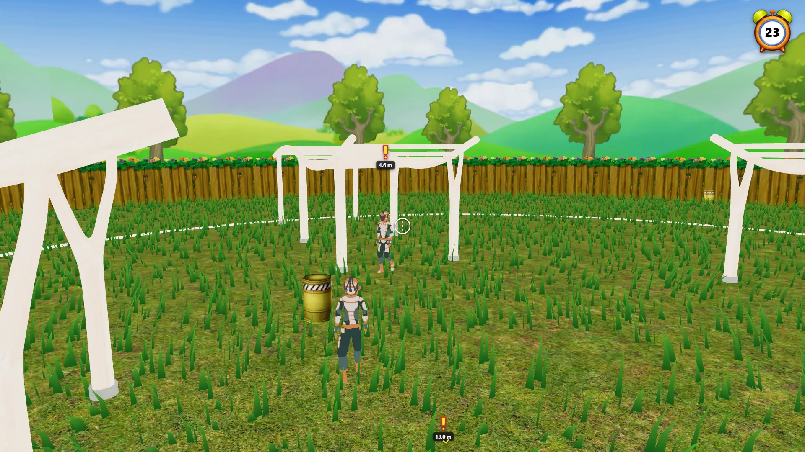

# Stop the Thieves



Stop the thieves from taking all your barrels. Shoot the thieves as they move towards the center. If they get too close they will grab a barrel and start walking away with it.

## Single Player

Open `/play` (or choose **Play Single Player** in the lobby), then press **Start Game** in the side menu. Single player disconnects the game socket and runs the simulation locally for 60 seconds.

The first 20 seconds have one thief moving at 1.5 units per second. From 20–40 seconds, two thieves move at 2.25 units per second. The final 20 seconds have three thieves moving at the full speed of 3 units per second.

Thieves seek the nearest available barrel and carry it toward the edge of the arena. On reaching the endpoint, the barrel is marked stolen and the thief respawns to seek another available barrel. Stolen barrels remain at their final positions for scoring. Shooting a thief before it escapes respawns it and drops its barrel at its current position. Hold left click, Enter, or the gamepad right trigger to fire once per second.

You can also shoot in the lobby and after game over. Shots pass through barrels and expire after 10 seconds if they have not already hit an enemy or the ground.

Each thief has a yellow exclamation mark outlined in red and a live distance from the player. Thieves outside the camera view have an indicator pinned to the nearest screen edge, with an arrow showing their direction. These indicators work in both camera modes and in single player or multiplayer.

The result is displayed as **Barrel Move Distance**: the sum of each barrel's final distance from its starting position. Lower is better, and zero is perfect. The most recent score and best (lowest) score persist in browser storage through `useScoreStore`.

For multiplayer, open `/play?server=1` or `/play?server=2`; **Start Game** sends the server's `game:stop-the-thieves:start-game` event.

## Getting Started

First you will need to setup a .env file from the .env.sample provided.

Then development server can be run:

```bash
npm run dev
```

## Multiplayer

Websocket backend code is not in this repo or available at this time.

## Scripts

In the scripts folder is reset_public and sync_to_s3. This is only for Articles Media usage. Allows for putting public folder to CloudFront to lower Vercel charges for the public facing site.
